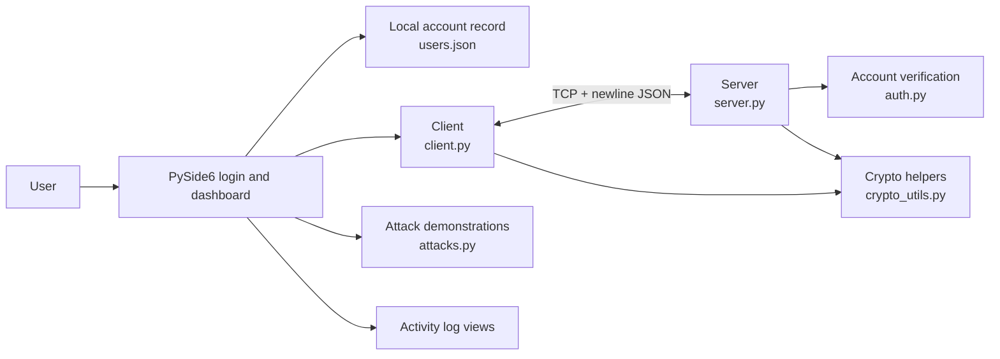

# Secure Mobile Communication Framework

## What the project does

This project is a Python desktop application that demonstrates a secure-messaging design. A PySide6 interface provides account registration and login, a dashboard, a secure-chat page, cryptographic information, activity logs, and attack-demo controls. A TCP client and server carry the messaging exchange.

The project is called a mobile communication framework, but the current user interface is a desktop application. It is best used to study how cryptographic building blocks can be composed in a messaging flow.

## Main components



### Important files

| File | Responsibility |
| --- | --- |
| `login.py` | Displays the login window and opens the dashboard after local verification. |
| `register.py` | Creates local accounts and stores a salted PBKDF2 password verifier in `users.json`. |
| `dashboard.py` | Builds the main interface and connects its pages and demo actions. |
| `pages.py` | Implements chat, cryptographic information, activity logs, and related dialogs. |
| `client.py` | Connects to the server, submits credentials and public keys, encrypts and signs messages, and handles responses. |
| `server.py` | Accepts TCP connections, checks credentials and message signatures, checks a counter, decrypts messages, and responds. |
| `auth.py` | Registers and verifies the server-side account records using PBKDF2-HMAC-SHA256. Its record format matches the GUI registration format in the current workspace. |
| `replay_protection.py` | Holds the shared counter rule used by the server and counter checks. |
| `crypto_utils.py` | Provides the ECDH, HKDF, AES-GCM, RSA-PSS, and related cryptographic helper functions. |
| `attacks.py` | Implements the eavesdropping display, ciphertext modification, and packet-resend demonstrations. |
| `security_test.py` | Runs eight isolated console checks for account authentication, cryptographic operations, and replay-counter ordering. |
| `assets/` | Contains visual assets and architecture diagrams used by the application and project materials. |

## Cryptography in the project

The application uses several primitives, each for a different purpose:

| Mechanism | Use in this project |
| --- | --- |
| **ECDH, SECP256R1 (P-256)** | Lets client and server derive a common secret from their private key and the other side’s public key. |
| **HKDF-SHA256** | Derives a 32-byte symmetric key from the ECDH secret, using the fixed info label `secure-mobile-communication`. The code passes no HKDF salt. |
| **AES-256-GCM** | Encrypts message text and checks an authentication tag when decrypting. The helper generates a random 12-byte nonce for each encryption and supplies no additional authenticated data (AAD). |
| **RSA-2048 with PSS and SHA-256** | Signs the counter, nonce, and ciphertext representation. The server verifies the signature using the client RSA public key supplied during that connection. |
| **PBKDF2-HMAC-SHA256** | Derives a password verifier from the password and a random 16-byte salt, using 100,000 iterations. Registration stores the salt and verifier rather than the original password. |

These mechanisms provide different protections. Encryption does not, by itself, prove who sent a message. A signature is only tied to an identity when the verification key is trusted and bound to that identity. The current exchange does not establish that trust binding.

## How a message is sent

The implemented client/server flow is approximately:

1. The user signs in to the desktop interface; the local login code checks the account record.
2. The client opens a TCP connection and submits the username and password as newline-delimited JSON.
3. The server checks the account record and returns its P-256 public key and the user's latest accepted counter.
4. The client sends its P-256 public key and RSA public key. Both sides derive the ECDH shared secret and HKDF session key.
5. The client encrypts the message with AES-GCM and creates a signature over the counter, nonce, and ciphertext fields.
6. The server verifies the signature, checks the per-user counter, decrypts the message, records the accepted counter, and returns a response.

This is a description of the current code path, not a claim that all steps are protected against an active network attacker.

## Attack demonstrations

The interface presents three scenarios:

- **Eavesdropping:** The demo displays ciphertext and labels it protected. The helper formats the supplied packet locally; it is not a live network packet capture.
- **Tampering:** The helper flips a ciphertext bit but retains the original signature, then submits it through the normal authentication and key setup. The server rejects it with `SIGNATURE_INVALID`.
- **Replay:** The helper resends an accepted packet through the normal handshake. The server rejects its duplicate counter with `REPLAY_ATTACK_DETECTED`.

The eavesdropping view displays the client's packet locally and is not a live network capture. The tampering and replay results exercise the corresponding server checks through a valid protocol flow.

## Running the application

Install [`uv`](https://docs.astral.sh/uv/) if needed. From the project directory, install the locked dependencies:

```bash
uv sync
```

Open two terminals in the project directory. Start the server first:

```bash
uv run python server.py
```

Then start the login interface:

```bash
uv run python login.py
```

Create an account through the registration screen, then sign in. The server and client are configured for `127.0.0.1:5000`. Keep both processes running while using the chat page. For a report-oriented capture checklist, see [`SCREENSHOTS_GUIDE.md`](../SCREENSHOTS_GUIDE.md).

The optional console checks can be run with:

```bash
uv run python security_test.py
```

This script prints PASS/FAIL-style results for eight focused checks. The account test uses a temporary account file and does not depend on the user's `users.json`.

## Current engineering limits

- **Transport:** The client sends account credentials over plaintext TCP; the project does not add TLS.
- **Peer identity:** The server’s ECDH public key is not authenticated, and the client RSA key is supplied by the same connection rather than linked to a trusted account identity.
- **Replay handling:** The server tracks counters per username in memory. The client reads the latest accepted counter and sends the next value; server restart clears this history.
- **Attack-test coverage:** Tampering and replay helpers perform the normal authentication and key setup. Eavesdropping remains a local packet display, not a live wire capture.
- **Server robustness:** Requests are limited to 1 MiB and connections have a 10-second timeout, but the server handles one connection at a time.
- **Dashboard status:** Some security cards and initial activity messages are static interface content, not evidence that a live cryptographic event occurred.

## Generated presentation

The presentation files are grouped here: [PowerPoint](Secure_Mobile_Communication_Framework_BTP.pptx), [image captions](PRESENTATION_IMAGE_CAPTIONS.md), and this explanation in Markdown and PDF. The deck’s attack-result interpretation describes the outcomes shown by the interface and distinguishes them from proof of a particular cryptographic check.
